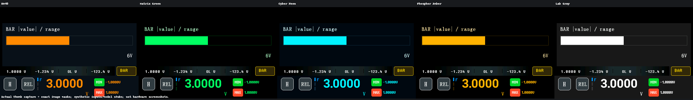
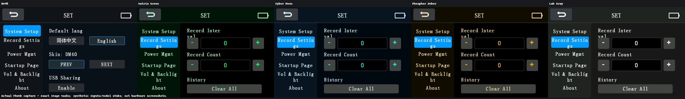
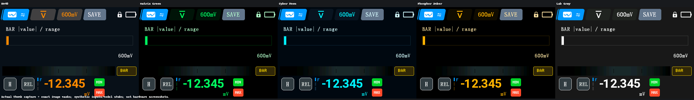
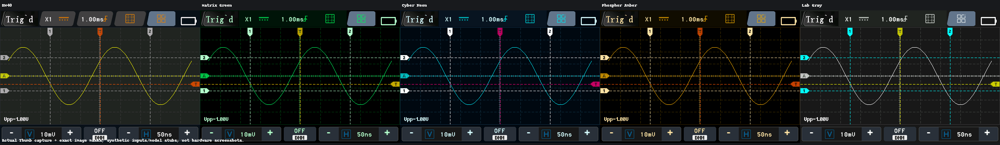
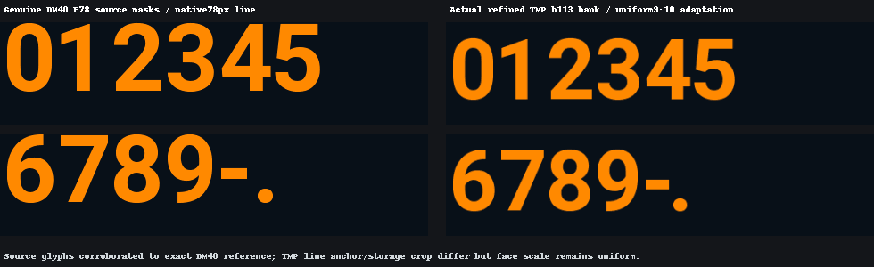
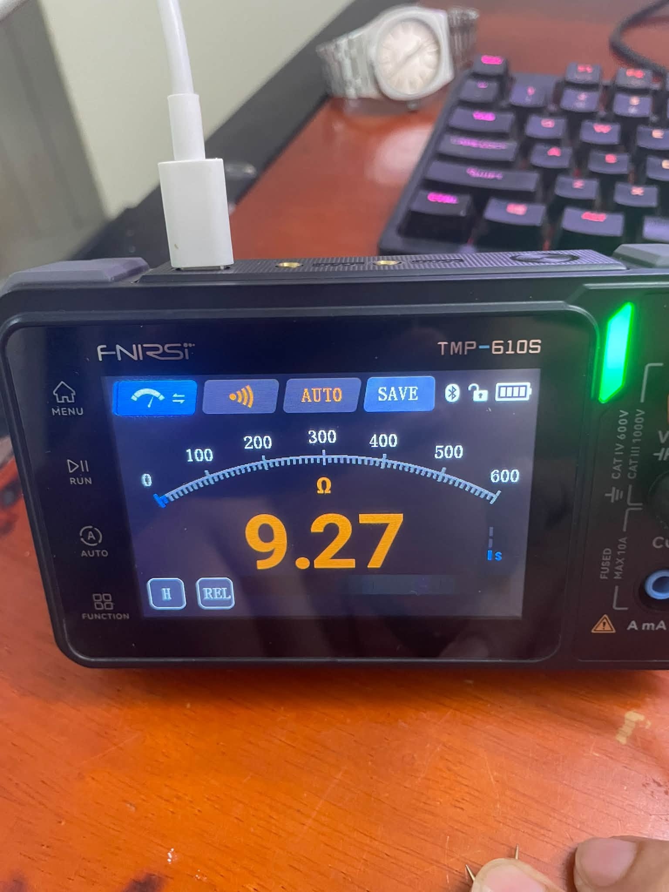
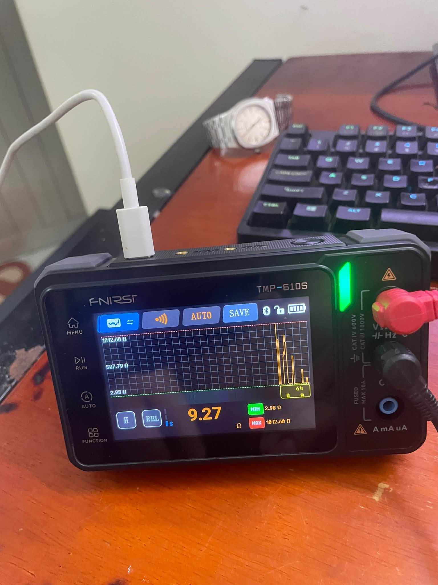
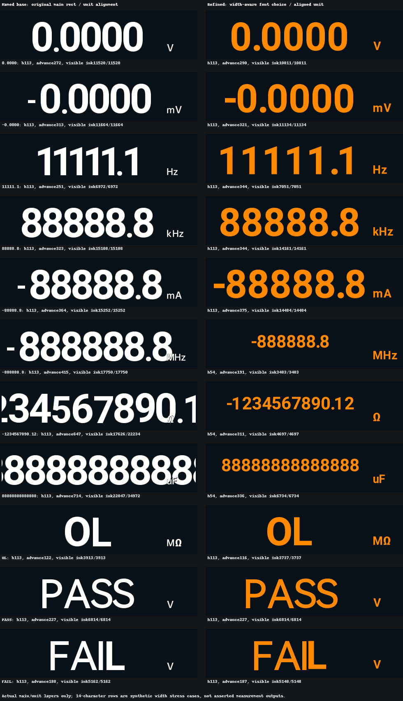
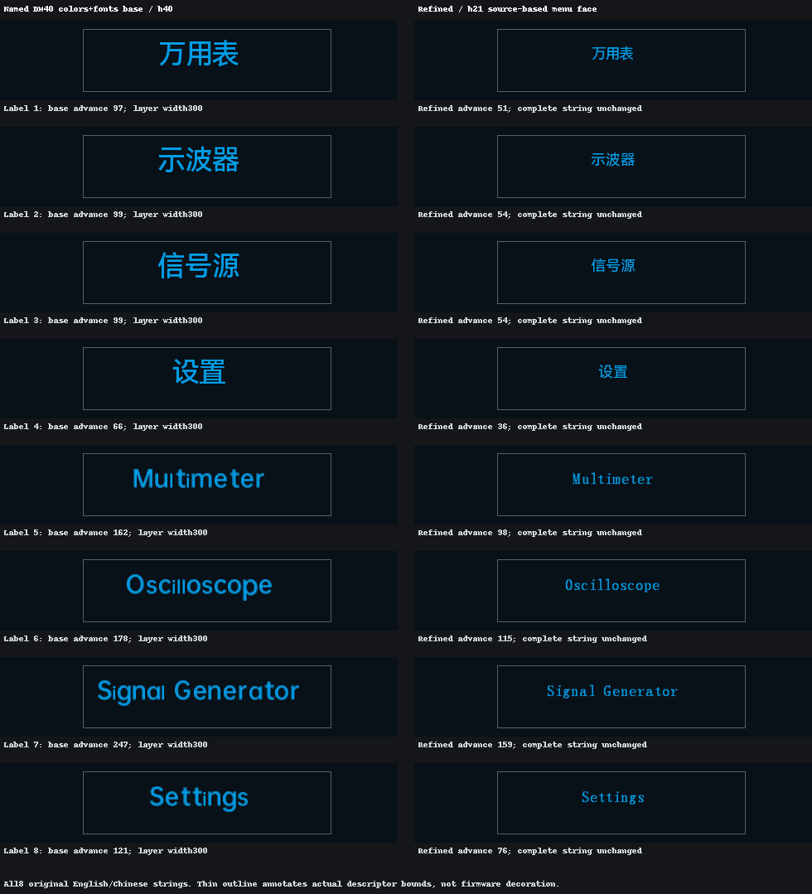
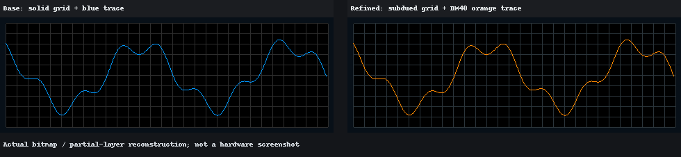

# DM40 Style for FNIRSI TMP-610S

A community firmware mod for the **FNIRSI TMP-610S**, shared as a prebuilt V1.9.9 binary with DM40-style UI reference previews.

[Download Firmware](binary/APP_TMP-610S_V1.9.9_260716_dm40-bar-allmodes.bin) | [Upgrade Guide](docs/UPGRADE.md) | [Tiếng Việt](README.vi.md) | [Release Notes](CHANGELOG.md)

## New: Bar Display + Five Skins

**The highlight of this update is the bar display mod**, accompanied by five visual skins for the TMP-610S.



| Skin | Preview palette |
| --- | --- |
| DM40 | Orange on dark background |
| Matrix Green | Bright green on black |
| Cyber Neon | Cyan on dark background |
| Phosphor Amber | Amber on black |
| Lab Gray | White and gray |

The supplied previews cover the menu, DMM, scope, and DMM bar views. The bar preview is labeled `|value| / range` and shows the reading magnitude relative to the range. Example inputs include zero, positive and negative values, OL, and HOLD; these are synthetic display cases, not measurement tests.





**Download:** [APP_TMP-610S_V1.9.9_260716_dm40-bar-allmodes.bin](binary/APP_TMP-610S_V1.9.9_260716_dm40-bar-allmodes.bin). The [previous DM40 binary](binary/APP_TMP-610S_V1.9.9_260716_dm40.bin) remains available.

These images are software reconstructions from the supplied `output/`, not photographs. The preview manifest's output hash differs from the new release binary. They illustrate the design; exact correspondence and operation on hardware are not established by these images. See [verification notes](docs/VERIFICATION.md) and the [full preview index](output/INDEX.md).


## Overview

This project shares a firmware mod focused on the display's visual style. The supplied development previews illustrate adapted DM40 digit shapes, unit labels, home-screen labels, status glyphs, and an orange graph trace on a dark background.

**The PNG development previews reconstruct selected UI layers.** Real-device photos are shown below. Their recorded firmware hashes differ from the distributed binary. They illustrate the development work but do not establish the exact appearance of this download. See [artifact verification](docs/VERIFICATION.md).



## Running on Real Hardware

Photos supplied by the project owner show the mod running on a **FNIRSI TMP-610S**. Both views display **9.27 Ω**, with orange digits on a dark background.

### Analog-Style Meter View



The meter view shows the large orange reading, resistance unit, curved scale, and H/REL controls on the physical display.

### Graph View



The graph view shows the orange trace, grid, live reading, and MIN/MAX fields on the device.

These photos document the visible interface on real hardware. The displayed values are observations from the photos, not accuracy-test results. Firmware version and binary SHA-256 are not visible in the photos; the existing manifest hash differences remain documented in [verification notes](docs/VERIFICATION.md).

## Download

| Item | Details |
| --- | --- |
| Intended device | FNIRSI TMP-610S |
| Version label | V1.9.9 / DM40 mod, as named in the supplied file |
| Firmware | [`APP_TMP-610S_V1.9.9_260716_dm40-bar-allmodes.bin`](binary/APP_TMP-610S_V1.9.9_260716_dm40-bar-allmodes.bin) |
| Size | 946,176 bytes |
| Integrity | [SHA256SUMS.txt](binary/SHA256SUMS.txt) |
| Hardware evidence | Owner-supplied TMP-610S photos in meter and graph views; see below |

Open the firmware link and use GitHub's **Download raw file** button, or download the repository using **Code > Download ZIP**. Extract the ZIP before flashing. Transfer only the `.bin` file to the device.

This is an unofficial mod. The shared manual covers both TMP-600 and TMP-610S; that does not establish compatibility of this binary with TMP-600, DM40, or other devices. The version label is not a claim that V1.9.9 is the latest official firmware.

## Upgrade

The bundled manual, section **3.6 Firmware Upgrade**, printed page **22** (PDF page **25**), describes this process:

1. With the device powered off, quickly press **Power three times** to enter the firmware upgrade screen.
2. Connect it to a computer with a USB-C **data** cable.
3. When the device appears as a USB drive, copy the downloaded `.bin` into that drive.
4. Wait for the transfer and update to finish, then restart the device.

Read the [full upgrade guide](docs/UPGRADE.md) first for checksum verification, preparation, and troubleshooting. Bootloader acceptance and operation of this specific mod have not been established by the supplied previews.

## Preview Gallery

The "before" panels use the development base recorded in the manifests, which is itself named `dm40-colors-fonts`; they are not established as stock FNIRSI firmware comparisons.

### Meter Digits and Units



Long numeric examples are synthetic layout tests, not measured values or additional measurement capability.

### Home Labels



### Graph Appearance



Graph data are synthetic. More samples and limitations are documented in [images/README.md](images/README.md).

## Repository Layout

```text
binary/             Firmware binary and SHA-256 checksum
images/             Real-device photos, UI previews, and development manifests
docs/               Upgrade guide, verification notes, sharing text, manual
README.md           English overview
README.vi.md        Vietnamese overview and upgrade instructions
CHANGELOG.md        Notes for this packaged mod
```

This repository distributes a prebuilt binary and supporting artifacts. Build scripts and patching tools are not included, so it is not currently a reproducible source release. Original manifest paths are preserved as development metadata.

## Feedback

Report the device model, hardware revision if known, previous firmware, downloaded file's SHA-256, reproduction steps, and a photo of the result. Please distinguish a device observation from a reconstructed preview.

## Credits

FNIRSI is the device manufacturer. DM40-style reference assets and the manufacturer manual retain their respective ownership. This repository is a community project and is not presented as an official FNIRSI release. No blanket software license is assigned to the bundled firmware or third-party assets.

Official resources: [TMP-610S product page](https://www.fnirsi.com/products/tmp-610s) | [Manuals and firmware](https://www.fnirsi.com/pages/manuals-firmwares).
