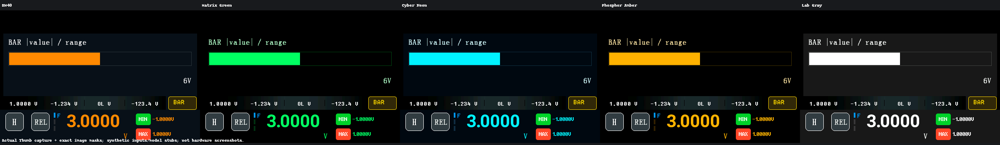
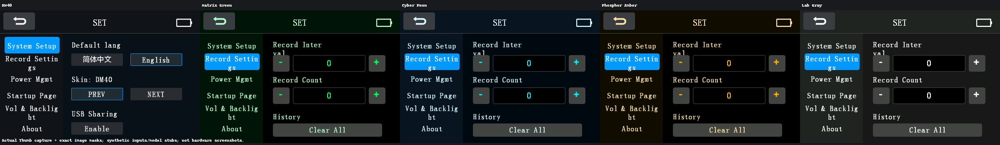
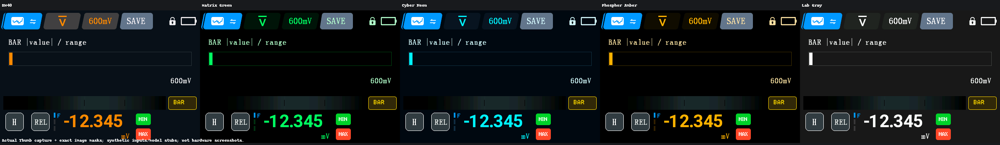
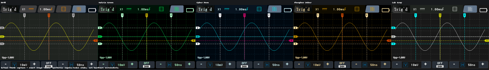
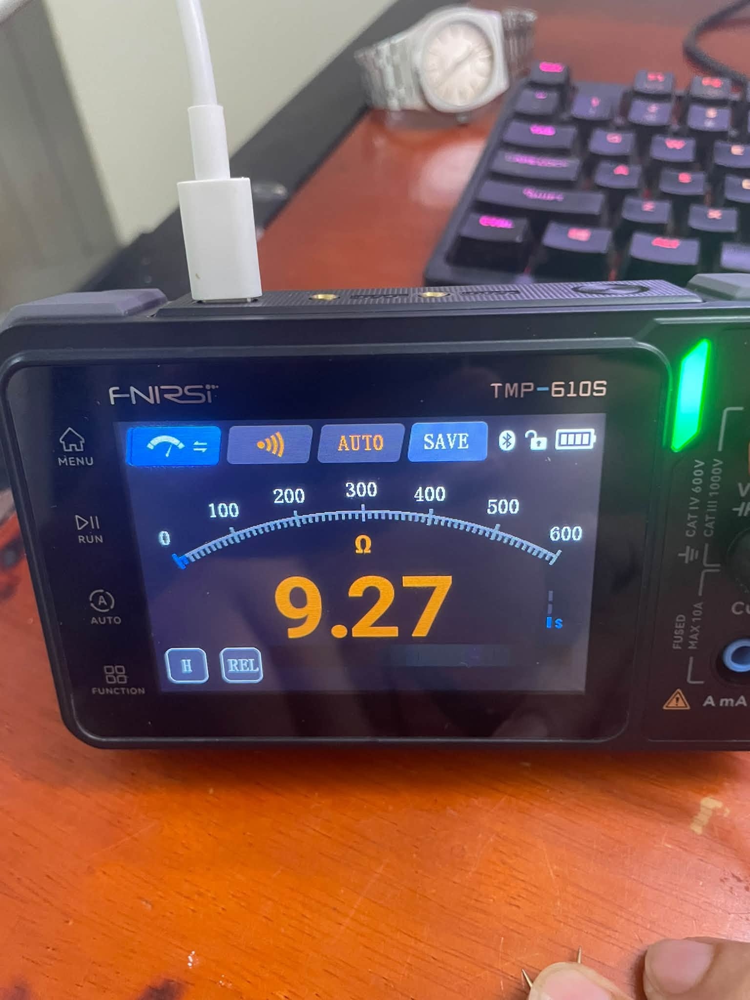
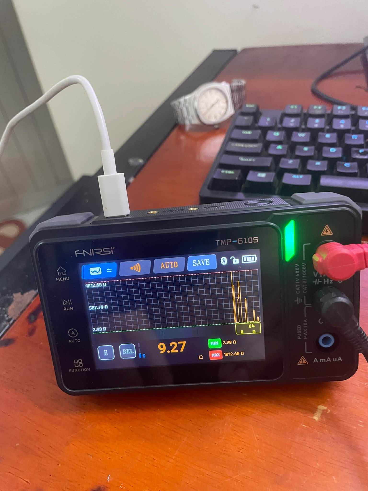

# DM40 mod cho FNIRSI TMP-610S

Mình làm bản mod này để đổi giao diện TMP-610S theo phong cách DM40, thêm vài skin và chế độ hiển thị bar. Bản mới đã được mình nạp và test trên TMP-610S thật, máy chạy bình thường.

[Tải firmware](binary/APP_TMP-610S_V1.9.9_260716_dm40-bar-allmodes.bin) | [English](README.md) | [Changelog](CHANGELOG.md)

## Bản này có gì?

Thay đổi chính là **hiển thị bar**: ngoài trị số, bạn có thêm một thanh biểu diễn độ lớn giá trị so với thang đo. Giao diện vẫn giữ bộ chữ số kiểu DM40 và có 5 skin để chọn:

| Skin | Tông màu |
| --- | --- |
| DM40 | Cam, nền tối |
| Matrix Green | Xanh lá, nền đen |
| Cyber Neon | Cyan, nền tối |
| Phosphor Amber | Hổ phách, nền đen |
| Lab Gray | Trắng và xám |



## Xem giao diện

Các ảnh dưới đây là preview giao diện từ bộ ảnh phát triển. Ảnh chụp máy thật nằm ở phần tiếp theo.

### Menu chọn skin



### Đồng hồ số



### Scope



## Ảnh máy thật

Ảnh trong quá trình làm bản mod trên TMP-610S:





## Tải firmware

Bản mới: [APP_TMP-610S_V1.9.9_260716_dm40-bar-allmodes.bin](binary/APP_TMP-610S_V1.9.9_260716_dm40-bar-allmodes.bin).

Trên GitHub, mở link rồi chọn **Download raw file**. Bạn cũng có thể tải cả repo bằng **Code > Download ZIP** rồi giải nén.

[Bản DM40 trước](binary/APP_TMP-610S_V1.9.9_260716_dm40.bin) vẫn nằm trong `binary/`. Checksum của cả hai bản có tại [SHA256SUMS.txt](binary/SHA256SUMS.txt).

## Cách nâng cấp

Chuẩn bị máy đủ pin và một cáp USB-C truyền được dữ liệu. Tháo dây đo trước khi cập nhật.

1. Tắt TMP-610S, sau đó nhấn nhanh nút **Power 3 lần** để vào màn hình **Firmware Upgrade**.
2. Nối máy với máy tính bằng cáp USB-C.
3. Chờ máy tính nhận TMP-610S như một ổ USB.
4. Chép file `APP_TMP-610S_V1.9.9_260716_dm40-bar-allmodes.bin` vào thư mục gốc của ổ USB đó.
5. Chờ chép và cập nhật xong rồi khởi động lại máy. Giữ nguyên kết nối trong lúc cập nhật.

Chỉ cần chép file `.bin`, không chép cả thư mục repo hay file ZIP. Nếu máy tính không nhận ổ USB, thử cáp dữ liệu khác.

Các bước trên theo mục 3.6 của manual đi kèm. Xem thêm [hướng dẫn chi tiết](docs/UPGRADE.md).

Muốn kiểm tra file tải về bằng PowerShell:

```powershell
Get-FileHash -Algorithm SHA256 -LiteralPath '.\binary\APP_TMP-610S_V1.9.9_260716_dm40-bar-allmodes.bin'
```

Đối chiếu kết quả với `binary/SHA256SUMS.txt`.

## Các thư mục

```text
binary/     Firmware và checksum
images/     Ảnh máy thật và gallery giao diện
output/     Bộ preview đầy đủ và dữ liệu phát triển
docs/       Manual, hướng dẫn và ghi chú kỹ thuật
```

Đây là bản mod cộng đồng cho FNIRSI TMP-610S. Nếu gặp lỗi, mở issue kèm skin đang dùng, chế độ hoạt động, cách tái hiện và ảnh hoặc video để mình kiểm tra.
