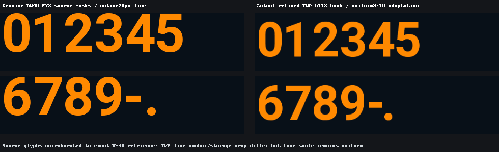

# DM40 Style cho FNIRSI TMP-610S

Bản firmware mod cộng đồng dành cho **FNIRSI TMP-610S**, chia sẻ dưới dạng file `.bin` mang nhãn **V1.9.9**, kèm ảnh tham khảo giao diện theo phong cách DM40.

[Tải firmware](binary/APP_TMP-610S_V1.9.9_260716_dm40-bar-allmodes.bin) | [English](README.md) | [Hướng dẫn chi tiết](docs/UPGRADE.md)

## Mới: mod hiển thị bar và 5 skin

**Điểm nổi bật của bản cập nhật là mod hiển thị bar**, đi kèm bộ 5 skin cho TMP-610S: **DM40, Matrix Green, Cyber Neon, Phosphor Amber và Lab Gray**.


| Skin | Màu trong preview |
| --- | --- |
| DM40 | Cam trên nền tối |
| Matrix Green | Xanh lá trên nền đen |
| Cyber Neon | Xanh cyan trên nền tối |
| Phosphor Amber | Hổ phách trên nền đen |
| Lab Gray | Trắng và xám |

Bộ preview có menu, đồng hồ số (DMM), scope và bar của DMM. Bar được ghi `|value| / range`, biểu diễn độ lớn trị số so với thang đo. Các mẫu zero, số dương, số âm, OL và HOLD dùng dữ liệu mô phỏng để kiểm tra hiển thị.


**Tải bản mới:** [APP_TMP-610S_V1.9.9_260716_dm40-bar-allmodes.bin](binary/APP_TMP-610S_V1.9.9_260716_dm40-bar-allmodes.bin). Vẫn giữ [bản DM40 trước](binary/APP_TMP-610S_V1.9.9_260716_dm40.bin).

Ảnh được dựng bằng phần mềm từ `output/`, không phải ảnh chụp máy thật. Hash trong manifest khác hash binary mới; ảnh minh họa thiết kế, chưa xác nhận chính xác giao diện của file phát hành. Xem [đối chiếu](docs/VERIFICATION.md) và [toàn bộ preview](output/INDEX.md).


## Giới thiệu

Bộ ảnh phát triển minh họa kiểu chữ số DM40 được điều chỉnh cho TMP, nhãn đơn vị, chữ trên màn hình chính, ký hiệu trạng thái và đường đồ thị màu cam trên nền tối.



**Các ảnh PNG phát triển được dựng lại từng lớp giao diện từ dữ liệu firmware.** Ảnh chụp thiết bị thật được trình bày ở mục bên dưới. Hash firmware trong các manifest khác hash file `.bin` đang chia sẻ. Vì vậy, ảnh chỉ dùng để tham khảo quá trình phát triển, chưa xác nhận chính xác giao diện của file tải xuống. Xem [đối chiếu dữ liệu](docs/VERIFICATION.md).

Các ảnh “before” dùng bản nền phát triển đã mang tên `dm40-colors-fonts`, không được xác nhận là firmware gốc của FNIRSI. Những chuỗi số dài và dữ liệu đồ thị là mẫu kiểm tra hiển thị, không phải kết quả đo.

## Ảnh chạy trên thiết bị thật

Ảnh do chủ dự án cung cấp cho thấy bản mod chạy trên **FNIRSI TMP-610S**, với chữ số màu cam trên nền tối. Cả hai ảnh đều hiển thị **9.27 Ω**.

### Giao diện đồng hồ kim


Ảnh cho thấy chữ số lớn màu cam, đơn vị điện trở, thang đo dạng cung và các nút H/REL trên màn hình thiết bị.

### Giao diện đồ thị


Ảnh cho thấy đường đồ thị màu cam, lưới, số đo hiện tại và các mục MIN/MAX trên máy thật.

Hai ảnh ghi nhận giao diện hiển thị trên phần cứng thực tế. Số đo trong ảnh chưa phải kết quả kiểm định độ chính xác. Ảnh không hiển thị phiên bản firmware hoặc SHA-256 của binary đã nạp; thông tin hash khác nhau trong manifest vẫn được ghi tại [tài liệu đối chiếu](docs/VERIFICATION.md).

## File tải xuống

| Mục | Thông tin |
| --- | --- |
| Thiết bị mục tiêu | FNIRSI TMP-610S |
| File | `APP_TMP-610S_V1.9.9_260716_dm40-bar-allmodes.bin` |
| Dung lượng | 946.176 byte |
| Checksum | [SHA256SUMS.txt](binary/SHA256SUMS.txt) |
| Bằng chứng máy thật | Ảnh TMP-610S do chủ dự án cung cấp ở giao diện đồng hồ kim và đồ thị |

Trên GitHub, mở link firmware rồi chọn **Download raw file**. Hoặc chọn **Code > Download ZIP** và giải nén. Thư mục `binary/` chứa file cần nạp.

Đây là bản mod không chính thức. Chỉ dùng cho thiết bị mục tiêu TMP-610S; manual dùng chung với TMP-600 không có nghĩa file này dùng được cho TMP-600 hay DM40. Nhãn V1.9.9 không có nghĩa đây là firmware chính thức mới nhất.

## Cách nâng cấp

Hướng dẫn dưới đây theo **mục 3.6**, trang in **22** / trang PDF **25** của [manual đi kèm](docs/TMP-610S_TMP-600_Manual_(EN).pdf).

### Chuẩn bị

- Tháo dây đo và các kết nối thử nghiệm; bảo đảm pin đủ để máy hoạt động suốt quá trình cập nhật.
- Ghi lại phiên bản hiện tại và cài đặt cần giữ. Chuẩn bị firmware gốc đúng model cùng hướng dẫn khôi phục từ [FNIRSI](https://www.fnirsi.com/pages/manuals-firmwares). Repo không có bản firmware gốc để khôi phục; khả năng hạ từ phiên bản mới hơn chưa được xác minh.
- Dùng cáp USB-C có truyền dữ liệu và kiểm tra checksum trước khi nạp.

Tại thư mục gốc repo, chạy PowerShell:

```powershell
Get-FileHash -Algorithm SHA256 -LiteralPath '.\binary\APP_TMP-610S_V1.9.9_260716_dm40-bar-allmodes.bin'
```

Kết quả phải khớp chuỗi sau, không phân biệt chữ hoa/thường:

```text
5e40700dda8615a584b3a12f803e8b82cd378ff2a2e439bdde31950a18325619
```

Checksum chỉ xác nhận đúng file được chia sẻ, không chứng minh file tương thích với phần cứng. Nếu không khớp, dừng và tải lại.

### Nạp firmware

1. **Tắt máy**, sau đó **nhấn nhanh nút Power 3 lần** theo manual đi kèm.
2. Xác nhận máy đã hiện màn hình **Firmware Upgrade**.
3. Kết nối với máy tính bằng cáp USB-C truyền dữ liệu.
4. Chờ máy tính nhận thiết bị như một ổ USB và xác định đúng ổ của thiết bị.
5. Chép duy nhất file `APP_TMP-610S_V1.9.9_260716_dm40-bar-allmodes.bin` vào thư mục gốc của ổ đó. Giữ nguyên tên file; không chép ZIP, PDF hay cả thư mục repo.
6. Chờ quá trình chép và cập nhật trên thiết bị kết thúc. Không rút cáp hoặc ngắt nguồn trong lúc cập nhật.
7. Khởi động lại sau khi hoàn tất. Kiểm tra menu, chữ số, dấu thập phân, dấu âm và đơn vị; kiểm tra chức năng đo với nguồn tham chiếu phù hợp trước khi sử dụng.

Nếu không vào được màn hình cập nhật, tra manual đúng phiên bản phần cứng trước khi tiếp tục. Nếu máy tính không nhận ổ USB, thử cáp dữ liệu khác và cổng USB trực tiếp. Khi cập nhật lỗi hoặc máy không khởi động, ghi lại lỗi và làm theo hướng dẫn khôi phục của FNIRSI cho đúng model. Repo chưa có quy trình khôi phục đã thử nghiệm cho bản mod này.

## Cấu trúc repo

- `binary/`: firmware và checksum SHA-256.
- `images/`: ảnh chụp thiết bị thật, ảnh minh họa cùng manifest phát triển gốc.
- `docs/`: manual, hướng dẫn nâng cấp, thông tin đối chiếu và bài đăng chia sẻ.
- `CHANGELOG.md`: ghi chú của gói chia sẻ.

Repo hiện chia sẻ binary có sẵn, chưa có mã nguồn và công cụ build/patch để tái tạo firmware. Không gán giấy phép mã nguồn mở chung cho firmware và tài nguyên của bên thứ ba.

Khi phản hồi, hãy gửi model, phiên bản phần cứng nếu biết, firmware trước khi nạp, SHA-256 của file đã dùng, cách tái hiện và ảnh chụp thiết bị.
